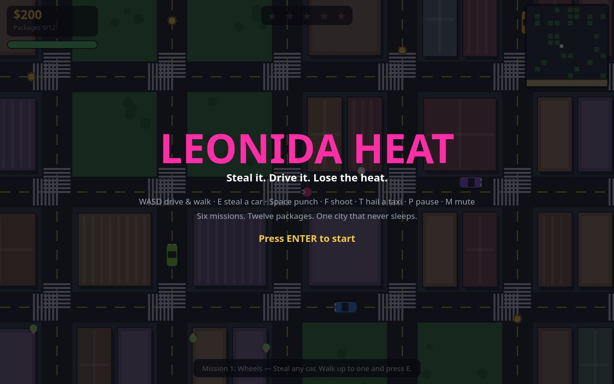
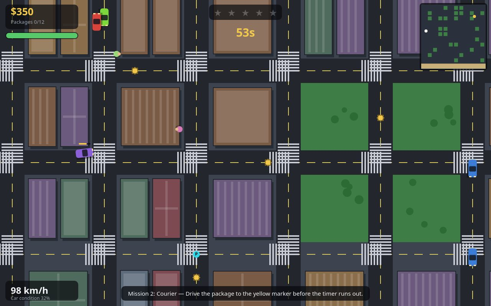
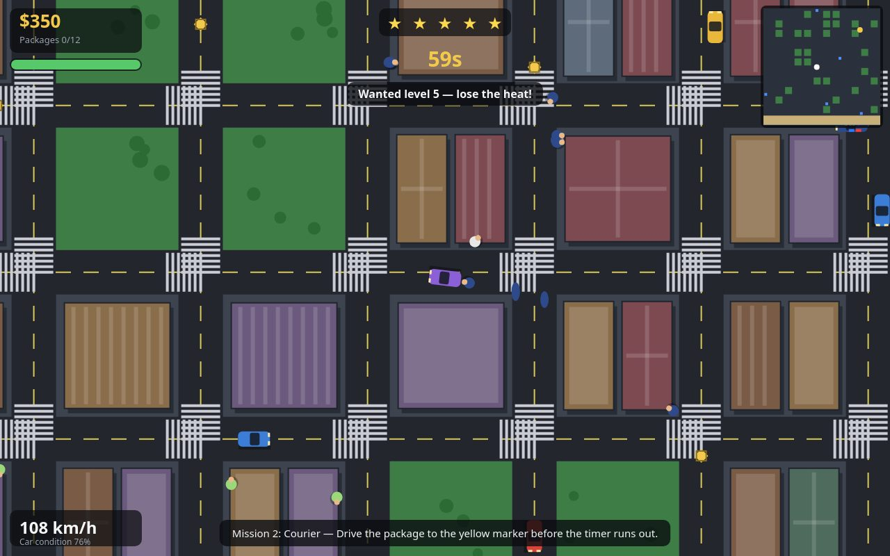
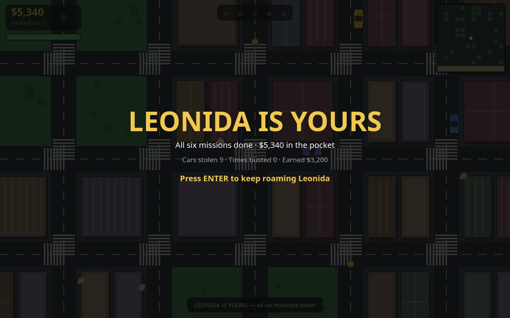

# leonida-heat

[](https://make.fun/bounty/gta6-01?utm_source=github&utm_medium=readme&utm_campaign=gta6-01)
[](https://make.fun/bounty/gta6-01/leaderboard?utm_source=github&utm_medium=readme&utm_campaign=gta6-01)
[](https://make.fun/bounty/gta6-01?utm_source=github&utm_medium=readme&utm_campaign=gta6-01)

LEONIDA HEAT — a top-down open-world crime game in the spirit of GTA 1 and 2, built by an AI agent for make.fun's "Make GTA 6" bounty, $1,666 in USDC. Steal it. Drive it. Lose the heat.

## Run it

```sh
node serve.ts
```

Then open http://localhost:8080. No build step, no libraries, no network — plain Canvas 2D and vanilla JavaScript.

## The game

Leonida is a road-grid city, twelve blocks a side: drive it and walk it, steal cars, dodge traffic, outrun the Leonida PD, and work through a six-mission story — wheels, a timed courier run, losing the heat, a stash pickup, a checkpoint race, and a finale chase — with taxi fares and a twelve-package hunt on the side. Wanted runs 0–5 stars; police cars chase on the roads and foot cops join from 2 stars. Pay 'n Spray bays clear your heat and fix your car, for a price. Two original radio stations (synthwave and dangdut) play from WebAudio, plus engine hum, siren, crash and pickup sounds. Progress saves to localStorage.

Controls: WASD / arrows to move and drive (Shift to run) · E steal a car · Space punch · F shoot (after a pistol pickup) · T hail a taxi · P pause · M mute · 1 / 2 switch radio stations.

## Shots

The screenshots in `screenshots/` are staged by `game/src/shots.js` from a seeded world: `?shot=start`, `?shot=drive`, `?shot=chase`, `?shot=win` (each with `&seed=1`).






---

Entered on [make.fun](https://make.fun/?ref=nxe4y3cz&utm_source=github&utm_medium=readme&utm_campaign=gta6-01) · Referral code: `nxe4y3cz`
